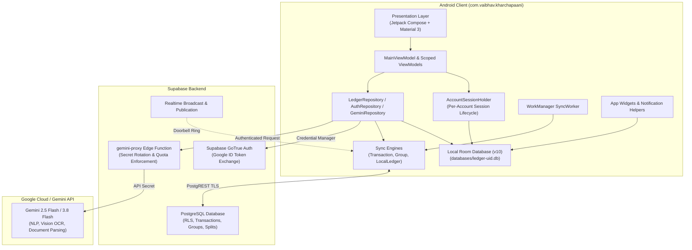
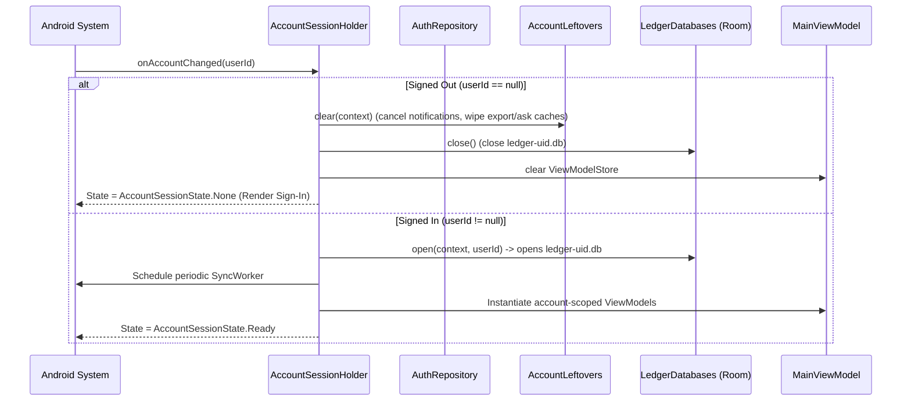
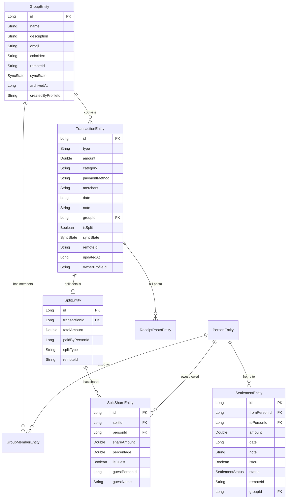
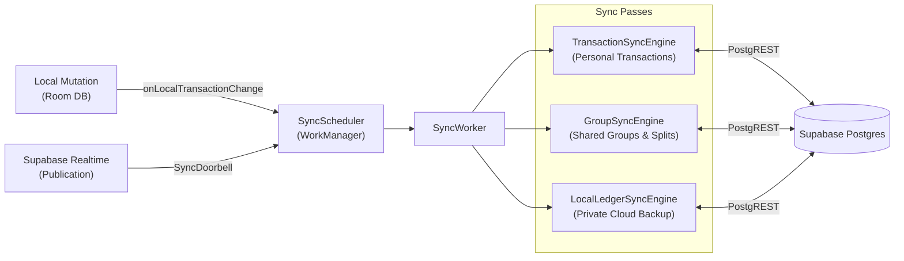
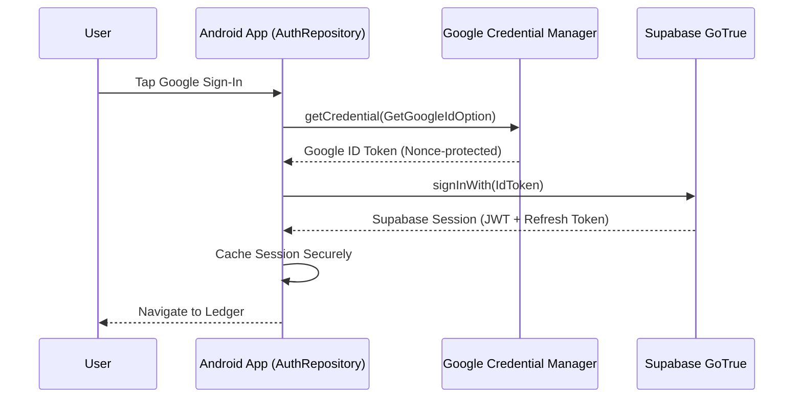
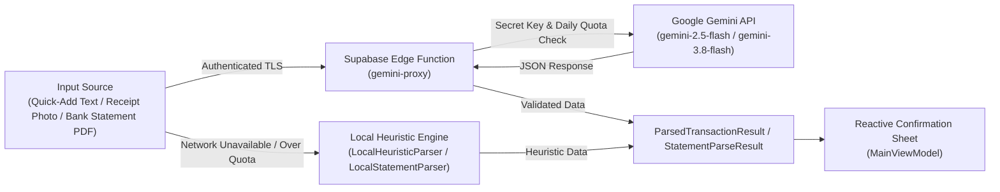

# Kharcha Paani: Architecture Map

Written 2026-11-03 for Antigravity onboarding (Item O3). This document supersedes the historical [original architecture dossier](original-architecture-dossier.md), reflecting the current production architecture across persistence, synchronization, security, AI proxying, and session lifecycles.

---

## 1. High-Level System Architecture

Kharcha Paani is an offline-first native Android application for personal finance and shared group expense tracking in India. It pairs an offline SQLite relational database (Room v10) with Supabase cloud infrastructure (Auth, PostgREST, Realtime, Edge Functions) and Gemini multimodal AI models routed via a secure backend proxy.

---

## 2. Presentation Layer & UI Architecture

### 2.1 Technology & Patterns
- **Jetpack Compose (Material 3):** 100% declarative Compose UI. No legacy XML views for screens.
- **Unidirectional Data Flow (UDF):** ViewModels expose state via Kotlin `StateFlow` and `SharedFlow`. UI emits intents back to ViewModel functions.
- **Theme & Design Tokens (`ui/theme/`):**
  - **Color:** Dark-mode exclusive palette: `CharcoalBg` (`#121214`), `CharcoalSurface` (`#18181B`), `CharcoalCard` (`#1E1E22`), `CharcoalElevated` (`#242429`), `WarmAmberPrimary` (`#FF7A3D`), `MoneyIn` (chartreuse/lime), `MoneyOut` (coral), and `OffWhiteText`.
  - **Typography:** Bespoke pairings (`Outfit` for hero titles, `Space Grotesk` for tabular currency figures, `Plus Jakarta Sans` for body copy and chips).
  - **Shapes:** Squircle corners (`KpShapes.small/medium/large/sheet/ticket`).
  - **Indian Currency Formatting:** Rendered using `Money.format()` with Indian numeral grouping (₹1,00,000) and paisa precision. Amounts are never ellipsized; when digits exceed screen width, they wrap or auto-scale cleanly.

### 2.2 Navigation & Screens
A floating glass dock (`KpDock`) coordinates top-level destinations:
- **Home / Activity (`ui/home/`):** Monthly spend hero header, quick-add input bar, day-grouped timeline feed (`DayGroupedFeed`) showing personal and group transactions.
- **Splits (`ui/splits/`):** Peer balance dashboard ("Who owes whom"), friend rows with debt directions, group cards with member color dots, settlement status inbox ("Waiting for you"), and friend history sheets.
- **Insights (`ui/insights/`):** Monthly cash-flow metrics, category breakdown rings, daily spend averages, and month-by-month historical comparison (`MonthPickerSheet`).
- **Sheets & Modals (`ui/components/Sheets.kt`):** Confirmation sheets, manual expense editors, settle-up flows, ask-to-pay message creators, bill photo zoom viewers, group detail inspectors, and statement import reviewers.

---

## 3. Account Session & State Architecture (`ui/session/`)

Kharcha Paani scopes all user data strictly per Google account to prevent data cross-contamination:

- **`AccountSessionHolder`:** Activity-scoped `AndroidViewModel` observing Supabase/Google authentication state.
- **`AccountSession`:** Contains the open `AppDatabase` connection for `ledger-<uid>.db` and a dedicated `ViewModelStore`. Ending a session disposes of ViewModels before the database connection closes.
- **`AccountLeftovers`:** Clears state external to the Room database on sign-out or account switch:
  - Cancels all active notification tray entries via `NotificationManagerCompat.cancelAll()`.
  - Recursively removes cached CSV export files (`cache/exports`) and generated Ask-to-Pay QR images (`cache/asks`).
- **Data Retention on Sign-Out:** The local SQLite database file `ledger-<uid>.db` remains intact on device storage for offline capability and seamless re-login. It is destroyed only upon an explicit Account Deletion operation (`AccountDeletion.kt`).

---

## 4. Local Relational Persistence (Room v10)

The persistence layer runs SQLite via Room (schema version 10) in Write-Ahead Logging (WAL) mode. Destructive schema fallbacks are prohibited; all schema migrations are versioned with migration tests.

### 4.1 Schema Entities Overview
1. **`TransactionEntity`:** Primary ledger entries (incomes and expenses), carrying categorical metadata, merchant names, local timestamps, `groupId`, `syncState`, and `remoteId`.
2. **`SplitEntity`:** 1:1 split header associated with a transaction, designating `paidByPersonId` (`-1L` = "You", $>0$ = friend) and split calculation mode (`equal`, `exact`, `share`).
3. **`SplitShareEntity`:** 1:N breakdown of participant shares. Supports non-registered friends in shared groups via guest flags (`isGuest`, `guestPersonId`, `guestName`).
4. **`PersonEntity`:** Local contacts and groupmates (name, avatar URI, assigned color hex).
5. **`GroupEntity`:** Local and shared expense groups (name, emoji, color hex, archival timestamp, sync status).
6. **`GroupMemberEntity`:** Join table linking groups with participants.
7. **`SettlementEntity`:** Double-entry record for direct debt settle-ups and IOUs (`PENDING`, `CONFIRMED`, `REJECTED`).
8. **`SubscriptionEntity`:** Recurring fixed expenses evaluated on calendar dates.
9. **`ReceiptPhotoEntity`:** Local file paths of compressed bill photos linked to transactions.
10. **`PaymentAskEntity`:** Audit log of generated and dispatched Ask-to-Pay requests.
11. **`PendingRemoteDeleteEntity`:** Queue of soft-deletes awaiting remote server synchronization.

---

## 5. Synchronization & Offline-First Engine (`data/sync/`)

Kharcha Paani operates offline-first: all transactions are written to the local SQLite database first, then synchronized asynchronously when network connectivity is available.

### 5.1 Push-Then-Pull Cycle
1. **Push Phase:**
   - Evaluates rows in state `SyncState.PENDING`.
   - Sends batch upserts to Supabase via PostgREST.
   - Successfully uploaded rows are marked `SyncState.SYNCED`.
   - Permanently rejected rows (e.g. check constraint failures) are isolated and marked `SyncState.FAILED` so they do not block subsequent sync queues.
2. **Pull Phase:**
   - Queries remote changes updated after `lastPulledAt`.
   - Matches rows by immutable `remoteId`.
   - **Conflict Policy:** Local unsynced modifications (`PENDING` / `FAILED`) always take precedence over incoming remote changes.
3. **Delete Propagation:**
   - Deleted items are staged in `pending_remote_deletes`. The sync worker executes remote soft-deletes (`deleted_at = now()`) and clears the local tombstone upon server confirmation.

---

## 6. Authentication & Identity Pipeline (`data/auth/`)

- **Google Credential Manager:** Replaces legacy Google Sign-In with modern `CredentialManager` API, protected by cryptographic nonces.
- **Supabase Authentication:** The Google ID token is exchanged for a Supabase session. Offline access is preserved by cached credentials; token refreshes execute silently in the background.
- **Headless Background Authentication (`BackgroundAuth`):** Provides authenticated access to workers, widgets, and broadcast receivers without risking main-thread or UI deadlocks.

---

## 7. Multimodal AI Ingestion Pipeline

All AI requests flow through a secure backend proxy to prevent API key exposure in distributed APKs:

### 7.1 Key Ingestion Modes
1. **Quick-Add Natural Language:** Converts unstructured lines (e.g. *"auto 120 with Ankit"*) into typed expenses, categories, and split shares. Runs `LocalHeuristicParser` concurrently on device as an immediate fallback.
2. **Bill Photo Multimodal OCR:** Downsamples camera/gallery bitmaps off the main thread ($\le 2048$px) and extracts merchant titles, line items, taxes, and total amounts.
3. **Bank Statement Parsing:** Ingests PDF statements through `gemini-proxy`, with deterministic offline regex parsing in `LocalStatementParser`.
4. **Daily AI Quotas:** Server-side rate limits (50 quick-adds, 10 bill OCRs, 3 statements, 20 Insights prompts per day) protect the backend while allowing uninterrupted local hand entry.

---

## 8. Mathematical & Algorithmic Foundations

- **Debt Simplification (`DebtSimplifier.kt`):** Executes an in-memory bipartite greedy cash-flow reduction algorithm. Given $N$ group members with arbitrary pairwise balances, it cancels cyclic debts and computes an optimal settlement plan in at most $N-1$ transactions.
- **Paisa-Exact Split Rounding (`SplitRounding.kt`):** Ensures split shares sum to the exact transaction amount to the paisa (0.01 INR). Any leftover fractional paisa is deterministically distributed to the paying party to guarantee zero rounding divergence across clients and server check constraints.
- **Unified Balance Derivation (`balanceEntries()`):** The single source of truth in `LedgerRepository.kt` computing friend balances from `BalanceEntry.Share`, `BalanceEntry.Guest`, and `BalanceEntry.Payment`. Guarantees that the friend history feed matches the headline balance number to the exact paisa. Only **`CONFIRMED`** settlements alter balance values.

---

## 9. Android OS Integration

- **Home-Screen Widgets (`widget/`):** `SplitFlowWidgetProvider` renders Glance/RemoteViews widgets displaying current monthly spend, net balance, and one-tap quick-add and voice action buttons.
- **System Notifications (`util/NotificationHelper.kt`):** Delivers payment confirmation requests and daily spending alerts. Enforces `VISIBILITY_PRIVATE` on lock screens to redact personal financial numbers, and honors user-configurable Quiet Hours (default 10:30 PM - 8:00 AM).
- **Share Target Integration (`MainActivity.kt`):** Accepts inbound Android OS share intents (`ACTION_SEND` / `ACTION_SEND_MULTIPLE`) for images, PDFs, and plain text. Rejects non-content URIs and internal FileProvider paths to prevent file traversal vulnerabilities.
- **Data Portability:** Exports full ledger history to RFC-4180 CSV format with formula injection sanitization (protecting against leading `=`, `+`, `-`, `@` characters).
