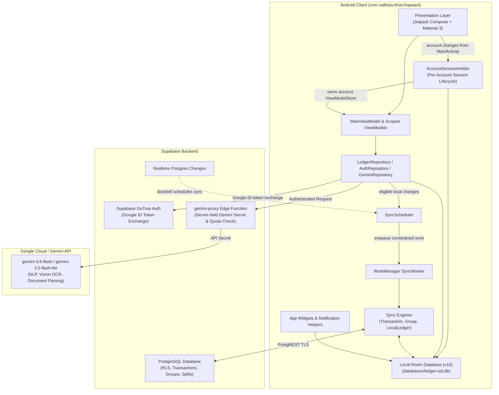
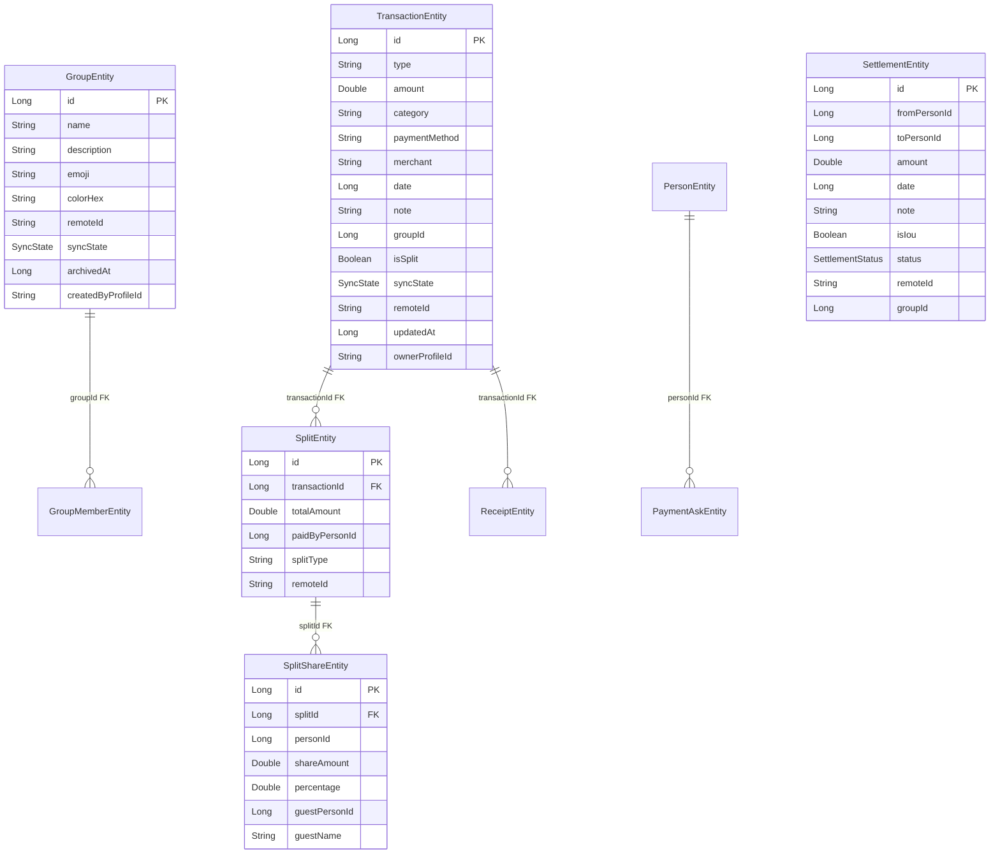
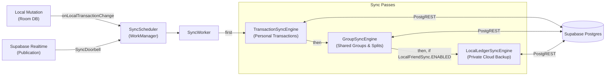
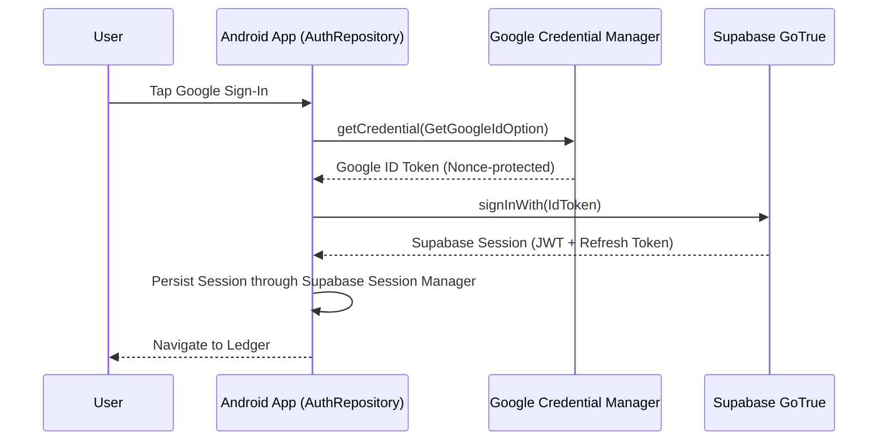
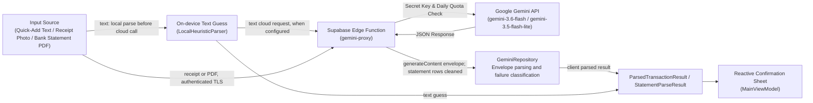

# Kharcha Paani: Architecture Map

Written for Antigravity onboarding (Item O3), checked against main `ebfc2b66110d0897685369f2c124fac2dec68862` on 2026-11-04. Use this source map alongside the historical [original architecture dossier](original-architecture-dossier.md). It describes checked-in implementation and configuration, not independently verified live services or phone behavior.

**Version boundary:** the `v1.6.0` tag is the phone-test release baseline. Main at the commit above also contains #195 sheet-first quick add: the phone guess opens the confirmation sheet before an AI improvement arrives. That behavior is absent from the tagged 1.6.0 text path, which waits for parsing before opening the sheet. This document does not establish which build is installed, phone acceptance, proxy deployment, applied SQL, live quotas, or old-key revocation.

---

## 1. High-Level System Architecture

Kharcha Paani is an offline-first native Android application for personal finance and shared group expense tracking in India. It pairs an offline SQLite relational database (Room v10) with Supabase cloud infrastructure (Auth, PostgREST, Realtime, Edge Functions) and Gemini multimodal AI requests routed through the checked-in `gemini-proxy` integration.



---

## 2. Presentation Layer & UI Architecture

### 2.1 Technology & Patterns
- **Jetpack Compose (Material 3):** Compose UI for the main screens and sheets. Platform date/time pickers and XML RemoteViews widgets also exist.
- **Unidirectional Data Flow (UDF):** ViewModels expose state via Kotlin `StateFlow` and `SharedFlow`. UI emits intents back to ViewModel functions.
- **Theme & Design Tokens (`ui/theme/`):**
  - **Color:** Dark-mode exclusive palette: `CharcoalBg` (`#0E0D0C`), `CharcoalSurface` (`#181615`), `CharcoalCard` (`#1E1C1A`), `CharcoalElevated` (`#22201D`), `WarmAmberPrimary` (`#FF7A3D`), `MoneyIn` (chartreuse/lime), `MoneyOut` (coral), and `OffWhiteText`.
  - **Typography:** Bespoke pairings (`Outfit` for hero titles, `Space Grotesk` for tabular currency figures, `Plus Jakarta Sans` for body copy and chips).
  - **Shapes:** Squircle corners (`KpShapes.small/medium/large/sheet/ticket`).
  - **Indian Currency Formatting:** Rendered using `Money.format()` with Indian numeral grouping (₹1,00,000) and paisa precision. Whole amounts are the product requirement; some components auto-size, but this is not a claim that every layout already meets it. The UI audit and deferred large-font work record remaining clipping/layout findings.

### 2.2 Navigation & Screens
A floating glass dock (`KpDock`) coordinates top-level destinations:
- **Home / Activity (`ui/screens/HomeScreen.kt`, with capture components under `ui/home/`):** Monthly spend hero, capture card and activity grouped by `ActivityDays.group`, including transactions and settlement/IOU items. Main uses a nullable `HomeSnapshot` and a brand mark until actual feed, people, balance and analytics sources have emitted.
- **Splits (`ui/screens/SplitsScreen.kt`):** Peer balance dashboard ("Who owes whom"), friend rows with debt directions, group cards with member color dots, settlement status inbox ("Waiting for you"), and friend history sheets.
- **Insights (`ui/screens/InsightsScreen.kt`):** Selected-month cash flow, category ring/breakdown and daily spending, with `MonthSwitcher` navigation and AI context for historical comparison.
- **Sheets & Modals (`ui/components/`, with account UI under `ui/auth/`):** Confirmation sheets, manual expense editors, settle-up flows, ask-to-pay message creators, bill photo zoom viewers, group detail inspectors, and statement import reviewers.

---

## 3. Account Session & State Architecture (`ui/session/`)

Ledger data is scoped by Supabase user ID; the current sign-in flow uses Google. Account-independent preferences are not a separate ledger:

```mermaid
sequenceDiagram
    participant Activity as MainActivity / AuthViewModel
    participant Holder as AccountSessionHolder
    participant Leftovers as AccountLeftovers
    participant Store as Account ViewModelStore
    participant DB as LedgerDatabases

    Activity->>Holder: onAccountChanged(userId or null)
    Holder->>Holder: cancel old account background sync
    Holder->>Leftovers: clear old notifications and share caches
    Holder->>Holder: set active account; cancel previous opening Job
    Holder->>Store: clear old account ViewModels
    Holder->>Holder: publish None
    alt Signed out
        Holder->>DB: close connection (retain file)
        Holder->>Holder: publish None
    else Signed in
        Holder->>Holder: publish Opening
        Holder->>DB: open user ledger (closes previous connection)
        Holder->>Holder: schedule periodic sync
        Holder->>Holder: publish Ready(session), or Failed(userId)
        Activity->>Store: instantiate account-scoped ViewModels
    end
```

- **`AccountSessionHolder`:** Activity-scoped `AndroidViewModel`. `MainActivity` collects `AuthViewModel.uiState` and calls `onAccountChanged` from a `LaunchedEffect`; the holder does not itself observe the authentication flow.
- **`AccountSession`:** Contains the open `AppDatabase` connection for `ledger-<uid>.db` and a dedicated `ViewModelStore`. Ending a session clears its ViewModelStore before the sign-out close or account-switch open. The holder does not await all scope Job completions. Activity-holder destruction clears ViewModels but leaves the process database open for widgets.
- **`AccountLeftovers`:** Clears state external to the Room database on sign-out or account switch:
  - Cancels all active notification tray entries via `NotificationManagerCompat.cancelAll()`.
  - Recursively removes cached CSV export files (`cache/exports`) and generated Ask-to-Pay QR images (`cache/asks`).
- **Data Retention on Sign-Out:** The local SQLite database file `ledger-<uid>.db` remains intact on device storage for offline capability and seamless re-login. Sign-out itself does not delete it. Explicit account deletion and Android uninstall/clear-data are separate removal paths.

---

## 4. Local Relational Persistence (Room v10)

The persistence layer runs SQLite via Room (schema version 10) through the shared Room builder; do not infer a custom journal-mode setting from this map. Destructive schema fallbacks are prohibited; all schema migrations are versioned with migration tests.



### 4.1 Schema Entities Overview
1. **`TransactionEntity`:** Primary ledger entries (incomes and expenses), carrying categorical metadata, merchant names, local timestamps, `groupId`, `syncState`, and `remoteId`.
2. **`SplitEntity`:** Split header associated with a transaction (normally one per transaction in app logic), designating `paidByPersonId` (`-1L` = "You", $>0$ = friend) and split calculation mode (`equal`, `exact`, `percentage`). Weighted allocation is implemented by `SplitRounding.byWeights`; `share` is not the persisted split-type name.
3. **`SplitShareEntity`:** 1:N breakdown of participant shares. Supports guests via nullable `guestName` and `guestPersonId`; `isGuest` is a computed property, not a database column.
4. **`PersonEntity`:** Local contacts and groupmates (name, avatar URI, assigned color hex).
5. **`GroupEntity`:** Local and shared expense groups (name, emoji, color hex, archival timestamp, sync status).
6. **`GroupMemberEntity`:** Join table linking groups with participants.
7. **`SettlementEntity`:** A directional row for payments and IOUs, with confirmation state (`PENDING`, `CONFIRMED`, `REJECTED`).
8. **`SubscriptionEntity`:** Recurring fixed expenses evaluated on calendar dates.
9. **`ReceiptEntity` (`receipts`):** Metadata linked to a transaction: a relative `fileName`, dimensions, bytes, timestamp and nullable `remotePath`. The local image is managed by `ReceiptStore`; it is not an absolute-path column or proof of cloud receipt storage.
10. **`PaymentAskEntity`:** Local log recorded when a share destination is selected, not merely when an ask preview is generated. It does not prove delivery to the friend.
11. **`PendingRemoteDeleteEntity`:** Existing queue of remote deletions/retractions, distinguished by `entityType`.
12. **`SyncMetaEntity`:** Key/value sync cursors and bookkeeping.

The ER edges show only enforced Room foreign keys, all CASCADE on delete; attribute lists are abbreviated. Other group/person IDs are logical references, not additional SQL FKs, and the self sentinel `-1L` does not require a person row. The application normally maintains one split per transaction, but the schema permits more than one: its transaction index is not unique.

---

## 5. Synchronization & Offline-First Engine (`data/sync/`)

Kharcha Paani operates offline-first: local changes are saved first. Only eligible PENDING records are uploaded; LOCAL_ONLY history is not universally promoted or uploaded. WorkManager uses a connectivity constraint and debounced requests.



### 5.1 Push-Then-Pull Cycle
1. **Push Phase:**
   - Evaluates rows in state `SyncState.PENDING`.
   - Sends batch upserts to Supabase via PostgREST.
   - Successfully uploaded rows are marked SYNCED only if their expected `updatedAt` still matches and they remain PENDING; a newer local edit wins.
   - Permanently rejected rows (e.g. check constraint failures) are isolated and marked `SyncState.FAILED` so they do not block subsequent sync queues.
2. **Pull Phase:**
   - Uses per-engine/table cursors in `sync_meta`, generally an inclusive `updated_at >= cursor` query with deliberate overlap and idempotent reapplication. There is no single universal `lastPulledAt` field.
   - Matches rows by immutable `remoteId`.
   - **Conflict Policy:** Local unsynced modifications (`PENDING` / `FAILED`) always take precedence over incoming remote changes.
3. **Delete Propagation:**
   - Eligible deletes use `pending_remote_deletes`; operations include soft deletes and local-ledger retraction RPCs. Successful sends clear their tombstones. Some permanently refused deletes are deliberately dropped and relevant pull cursors reset so the server version reappears; see the engine-specific handling.

`SyncWorker` runs personal, group and then enabled local-ledger sync sequentially under a process-wide mutex. Realtime is a doorbell that schedules a normal sync, not a direct ledger writer. `SupabaseLedgerChanges` subscribes to transactions, settlements and groups; the code relies on parent updates for unpublished child tables. Current whole-pass failures still lack the planned T2.4 persisted error UI; this map does not claim that work is implemented.

---

## 6. Authentication & Identity Pipeline (`data/auth/`)



- **Google Credential Manager:** Replaces legacy Google Sign-In with modern `CredentialManager` API, protected by cryptographic nonces.
- **Supabase Authentication:** The Google ID token is exchanged for a Supabase session. The app can retain account identity and open its local ledger using a stored session during refresh/network disruption. Network authorization can still fail; cached identity is not proof of a valid refreshed token.
- **Headless Background Authentication (`BackgroundAuth`):** Reads identity from memory/stored session and uses bounded initialization/storage-reload waits before background network work; it avoids waiting indefinitely for foreground initialization. This is not a guarantee that refresh/network authorization always succeeds.

---

## 7. Multimodal AI Ingestion Pipeline

The checked-in client directs AI requests to the authenticated `gemini-proxy` endpoint, whose code reads the Gemini key from a server secret. Deployment, configured secrets and live behavior require separate verification:



### 7.1 Key Ingestion Modes
1. **Quick-Add Natural Language:** `GeminiRepository.parseText` computes the local heuristic result first, then makes a cloud call when configured; it is sequential, not a race between two parsers. At checked main, #195 additionally opens the sheet on `MainViewModel.openOnPhoneGuess`, then runs cancellable AI improvement and preserves fields the person touched. The tagged 1.6.0 path waited for `parseText` before opening the sheet.
2. **Bill Photo Multimodal OCR:** Shared-image decoding targets a 2048 px long side in `SharedFiles` (older BitmapFactory sampling may be just above it). The AI request scales the long side to at most 1600 px and JPEG quality 85 in `GeminiRepository.bitmapToBase64`, then extracts receipt fields. A failed read leaves manual entry available; there is no claimed on-device receipt OCR fallback.
3. **Bank Statement Parsing:** `readStatementPdf` sends PDF data through the proxy and validates/reviews returned items. Its use of `LocalStatementParser.buildStatementGroups` groups already parsed rows; it does not extract PDF text offline. Network/quota/read failures surface a failure/manual-entry path, not an offline PDF import.
4. **Daily AI Quotas:** The checked-in SQL seeds per-user daily caps of 50 quick-adds, 10 bill reads, 3 statements and 20 Insights/trip reads, keyed to midnight IST. The proxy calls `take_ai_read`; caps can change server-side, and accepted calls spend a read even if Google fails. A fallback request can spend a second read. These are configured defaults, not live quota/deployment evidence. Local manual entry remains available.

The model IDs are source configuration, not a claim about current Google availability: `MODEL = gemini-3.6-flash`, `FALLBACK_MODEL = gemini-3.5-flash-lite`, matching the proxy allowlist. The general text/receipt/ask call wrapper retries once on server-error/rate-limit failures; the PDF path calls the primary endpoint directly.

---

## 8. Mathematical & Algorithmic Foundations

- **Debt Simplification (`DebtSimplifier.kt`):** `simplifyPositions` greedily matches debtors and creditors in an already-balanced net-position map; each transfer clears at least one remaining position, yielding at most active-members minus one transfers for balanced whole-paisa inputs. It does not guarantee a globally minimum transfer count or operate on a graph of arbitrary pairwise debts. `simplify` separately restricts friend-to-friend payments to people who share a group, with remaining amounts paid through you.
- **Paisa-Exact Split Rounding (`SplitRounding.kt`):** Ensures split shares sum to the exact transaction amount to the paisa (0.01 INR). Equal/weighted allocations use whole paisa and assign leftover paisa to the payer when present; otherwise the largest share absorbs it, first listed on ties. `normalize` rejects excessive drift or a negative adjusted share. This describes local arithmetic, not independent proof of deployed server constraints.
- **Unified Balance Derivation (`balanceEntries()`):** The single source of truth in `LedgerRepository.kt` computing friend balances from `BalanceEntry.Share`, `BalanceEntry.Guest`, and `BalanceEntry.Payment`. The implementation shares the same balance-entry derivation with friend history, with tests for consistency; this is not a phone/server acceptance claim. Only **`CONFIRMED`** settlements alter balance values.

---

## 9. Android OS Integration

- **Home-Screen Widgets (`widget/`):** `SplitFlowWidgetProvider` renders XML RemoteViews widgets displaying current monthly spend, net balance, and one-tap quick-add and voice action buttons.
- **System Notifications (`util/NotificationHelper.kt`):** Delivers payment confirmation requests and daily reminders when nothing has been logged. Enforces `VISIBILITY_PRIVATE` on lock screens to redact personal financial numbers, and honors user-configurable Quiet Hours (default 10:30 PM - 8:00 AM).
- **Share Target Integration (`MainActivity.kt`):** `IncomingIntents.route` handles `ACTION_SEND` for one image/PDF stream or typed text; it does not implement `ACTION_SEND_MULTIPLE`. Internal widget/notification actions require the non-exported activity alias; invite links use ACTION_VIEW. Rejects non-content URIs and internal FileProvider paths to prevent file traversal vulnerabilities.
- **Data Portability:** Exports the selected range of ledger entries to CSV using `CsvExport` with formula injection sanitization (protecting against leading `=`, `+`, `-`, `@` characters).

## Source and verification boundary

Relevant source at the checked commit: `MainActivity.kt`, `ui/session/AccountSessionHolder.kt`, `data/db/{AppDatabase,LedgerDatabases}.kt`, `data/db/entity/Entities.kt`, `data/sync/{SyncWorker,SyncDoorbell,TransactionSyncEngine,GroupSyncEngine,LocalLedgerSyncEngine}.kt`, `data/repository/GeminiRepository.kt`, `domain/{LocalStatementParser,DebtSimplifier,SplitRounding}.kt`, `util/SharedFiles.kt`, `IncomingIntents.kt`, and `supabase/functions/gemini-proxy/`. Reading these files establishes implementation/configuration only. This update did not run Gradle, a phone/emulator, Supabase SQL/deployment, or live AI calls.
